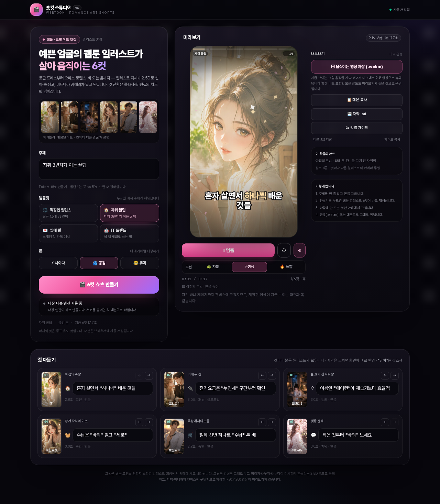
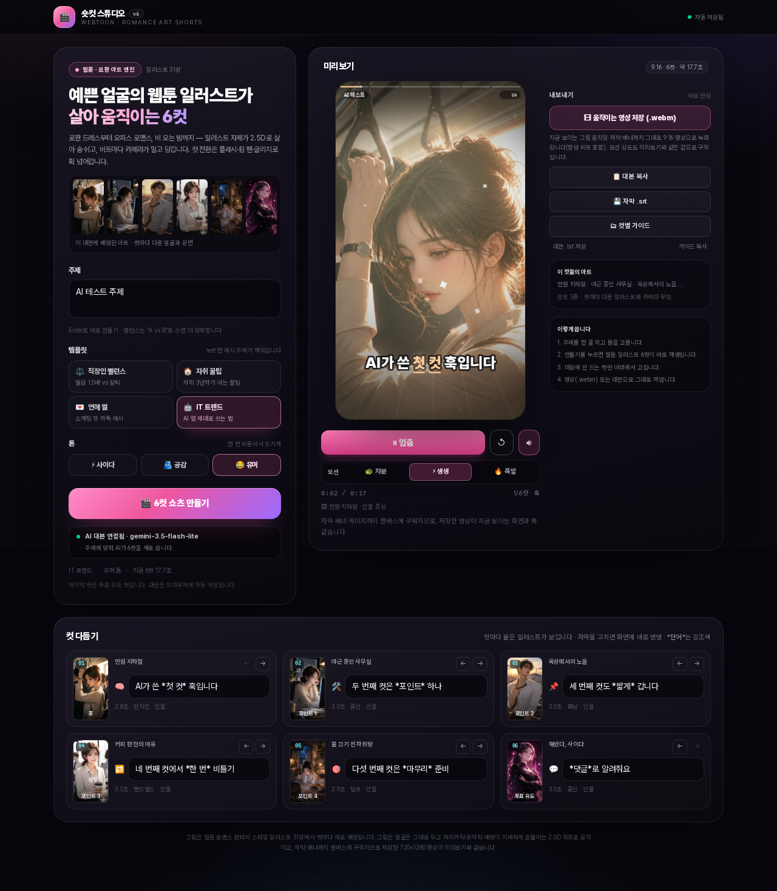
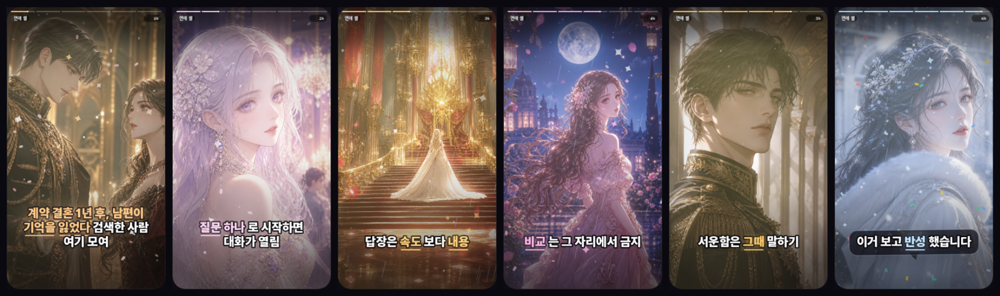
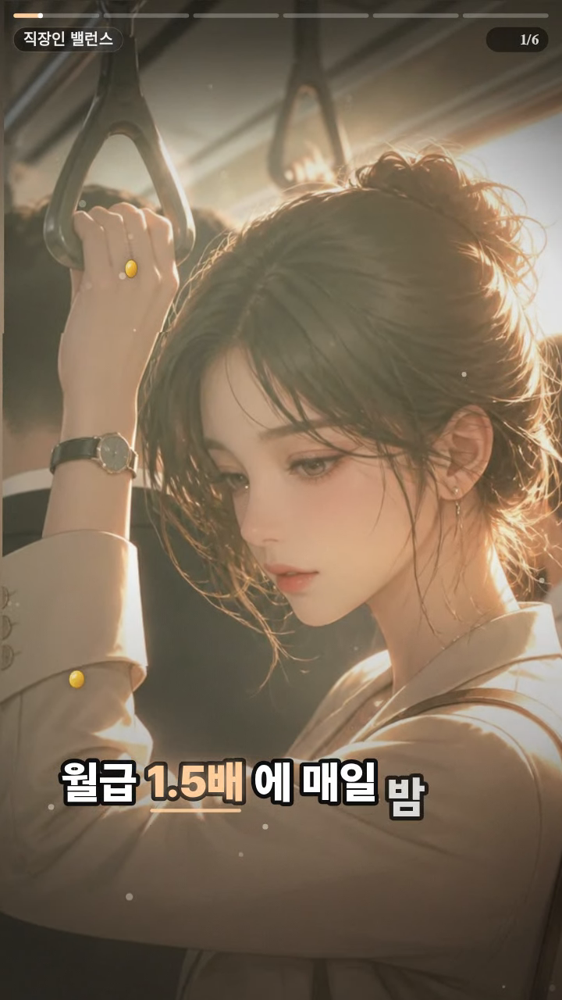

# 🎬 숏컷 스튜디오 (ShortCut Studio) v6

**주제 한 줄만 넣으면, 웹툰·로맨스 판타지 일러스트 6컷이 살아 움직이는 9:16 쇼츠가 나옵니다.**

한 장의 일러스트를 그냥 미는 게 아니라, **그림 자체가 2.5D로 숨 쉬고**(얼굴은 고정, 머리카락·옷자락·배경이
미세하게 흔들림) **비트마다 카메라가 밀고 당깁니다.** 컷 전환은 화이트 플래시 + 휩 팬 + 글리치 슬라이스로
휙 넘어가고, 자막은 단어별로 박자에 맞춰 박힙니다.
마음에 안 드는 컷은 자막 한 줄만 고치고, **움직이는 화면 그대로 720×1280 WebM 영상**으로 저장합니다.
이미지 API도, 유료 결제도, 서버 렌더링도 쓰지 않습니다.



---

## 1. 이번 개편(v6)에서 바꾼 것

> 지현 님 피드백: **"1 좋은데 지금 멈춰있는 사진이잖아 움직이게 못할까 영상처럼?"**
> v5는 일러스트 퀄리티는 올라갔지만, 한 장이 천천히 확대될 뿐이라 "사진"으로 보였습니다.

| v5 | 지금 (v6) |
| --- | --- |
| 일러스트 한 장을 통째로 켄 번즈 확대 (정지 사진 느낌) | **2.5D 워프** — 그림을 14×3 격자로 나눠 미세하게 어긋나게 그림. 얼굴은 그대로, 머리카락·옷자락·배경이 계속 흔들림 |
| 카메라가 컷마다 완만하게 한 번 | **비트 펀치** — 컷 안에서 자막 박자(16%·48%·80%)에 맞춰 2~3번 더 밀었다 놓음, 휩 팬·더치 앵글 추가 |
| 컷 전환은 화이트 플래시뿐 | **플래시 + 스피드 스트릭 + 줌 스미어 + 글리치 슬라이스** 로 휙 넘어감 |
| 자막은 HTML 오버레이(CSS 애니메이션) | **자막·배너·게이지를 캔버스에 구움** → 미리보기와 저장 영상이 100% 동일, 단어별 카라오케 + 키워드 발광·밑줄 |
| 미리보기 30fps, 배경 블러 때문에 실제로는 더 느림 | **60fps 지향** — backdrop-filter 제거, 기기 성능에 맞춰 미리보기 해상도 자동 조절 |
| 모션 세기 조절 없음 | **모션 강도 3단계(차분·생생·폭발)** — 미리보기에서 바로 바꾸고 저장 영상에도 같은 값 적용 |

### v5에서 이미 바꿔 둔 것

| 이전 (v4) | v5 |
| --- | --- |
| Canvas 도형으로 그린 막대·원형 캐릭터 — 사용자 평가: "PPT로 만든 일러스트" | **웹툰·로판 일러스트 31장**을 메인 비주얼로. 궁정 드레스·오피스 로맨스·비 오는 밤·카페 설렘·충격 클로즈업까지 실제 그림 |
| 컷마다 그림이 달라도 결국 같은 도형 캐릭터 | **컷마다 다른 일러스트**가 배정되고, 같은 영상에서 그림이 겹치지 않음 |
| 캔버스 도형 위에 이펙트만 얹음 | 일러스트 위에 **켄 번즈 카메라·색 보정·빛 번짐·파티클·전환 플래시·단어별 자막**을 합성 |
| 어두운 보라 UI, 각진 패널 | **크리에이터 스튜디오 감성** — Pretendard 자체 호스팅, 필름 그레인, 아트 썸네일 카드 |
| 주제와 그림의 결이 어긋남 | 주제가 '로판/계약 결혼'이면 **궁정 그림으로 고정**, '월급/칼퇴'면 **오피스 그림으로 고정** |

## 2. 1분 사용법

1. **주제**를 한 줄 적습니다. 예: `월급 1.5배 vs 칼퇴`, `계약 결혼 1년 후, 남편이 기억을 잃었다`
2. **템플릿**(직장인 밸런스 · 자취 꿀팁 · 연애 썰 · IT 트렌드)과 **톤**(사이다 · 공감 · 유머)을 고릅니다.
3. **🎬 6컷 쇼츠 만들기** — 대본과 함께 컷마다 일러스트가 배정되고 바로 재생됩니다.
4. 플레이어 아래 **🖼 장면** 줄과 컷 카드 썸네일로 이번 컷의 일러스트를 확인합니다.
5. **🎞 움직이는 영상 저장**을 누르면 화면 그대로 720×1280 `.webm`으로 녹화됩니다.
6. 대본이 필요하면 **대본 복사 / 자막 .srt / 컷별 가이드**로 꺼냅니다.

- 자막에서 `*단어*`처럼 별표로 감싸면 그 단어만 강조색으로 뜨고, 음성에서는 별표를 빼고 읽습니다.
- 만들 때마다 새 시드가 생겨 **같은 주제라도 컷 구성·카메라·색·이펙트가 달라집니다.**

| 모바일 (390px) | AI 대본 모드 |
| --- | --- |
|  |  |

**한 영상의 6컷 — 컷마다 다른 일러스트와 카메라**


**로판 주제(`계약 결혼 1년 후, 남편이 기억을 잃었다`)로 만든 6컷** — 주제가 장르를 말하면 궁정 일러스트로 고정됩니다



**녹화된 WebM의 실제 프레임** (일러스트 + HUD + 자막 + 이펙트가 그대로 구워집니다)



## 3. 일러스트 라이브러리 (`public/webtoon/`)

9:16(720×1280 WebP, 총 3.6MB) 일러스트 31장을 장르별로 나눠 두었습니다.
원본 941×1672 PNG와 생성 프롬프트는 `docs/art-catalog.md`, 원본은 `downloads/shortcut-studio-webtoon-masters/`에 있습니다.

| 장르 | 장수 | 예 |
| --- | --- | --- |
| 로맨스 판타지 | 6 | 은빛 드레스의 무도회 · 손을 내미는 공작 · 달빛 정원의 산책 · 황궁의 대연회장 · 황실 근위대장 · 눈 내리는 궁정 |
| 오피스 | 7 | 야근 중인 사무실 · 회의실의 충격 · 커피 한 잔의 여유 · 엘리베이터의 정장남 · 옥상에서의 노을 · 상사와의 대치 · 만원 지하철 |
| 비·감정 | 4 | 비 오는 밤 우산 아래 · 혼자 남은 비 오는 거리 · 빗물에 비친 얼굴 · 눈물 한 방울 |
| 카페 로맨스 | 3 | 창가 자리의 미소 · 마주 앉은 두 사람 · 라테 두 잔 |
| 코믹·사이다 | 4 | 한숨 나오는 순간 · 믿기지 않는 순간 · 해냈다, 사이다 · 월급이 쏟아진다 |
| 네온·IT | 4 | 출시 성공 · 네온 골목 · AI 작업실 · 도시의 밤 |
| 자취·일상 | 3 | 불 끄기 전 자취방 · 아침의 주방 · 벚꽃 산책 |

### 어떻게 컷에 배정되나 (`src/lib/motion/art.ts`)

- 각 일러스트에 한국어 **태그**(`궁정`, `야근`, `소개팅`, `지하철` …), 표정, 구도(close/medium/wide/two-shot), 초점 좌표, 강조색, 어울리는 공기(비·꽃잎·보케)를 붙였습니다.
- 대본의 `visual.scene`·소품·표정·자막을 읽어 태그 점수를 매기고, **템플릿·톤 적합도**, 컷 역할(훅/본문/CTA), 두 사람 구도까지 더해 고릅니다.
- 주제가 장르를 확실히 말하면(`로판·공작·계약 결혼` → 궁정, `월급·칼퇴·야근` → 오피스) 그 장르 안에서만 고릅니다. 장르 그림이 5장 이상일 때만 고정합니다.
- **같은 영상에서 이미 쓴 그림은 제외**하고, 앞 컷과 같은 장르·구도는 감점해 6컷이 겹치지 않습니다.
- 시드가 바뀌면 점수가 비슷한 후보 중 다른 그림이 뽑혀, 같은 주제를 다시 만들어도 새 영상이 됩니다.

## 4. 모션 엔진 (`src/lib/motion/`)

- **살아 있는 그림(live.ts)**: 일러스트를 14×3 격자로 나눠 그립니다. 초점(얼굴)에서 멀수록 크게 흔들리는
  변위장(사인파 2중 + 가우시안)을 적용하고, 인물은 카메라 이동의 반대로 조금 늦게 따라오게 해 **깊이(2.5D)** 를 만듭니다.
  격자 이음매는 30px 겹쳐 그려 보이지 않습니다.
- **카메라 10종**: push(줌인) · pull(줌아웃) · punch(펀치인) · whip(휩 팬) · drift(패닝) · tilt · shake · handheld · orbit · slide.
  컷 안에서 자막 박자에 맞춰 `beatPulse`가 2~3번 더 밀어 주고, 진입 순간에는 오버슈트(`entryKick`)가 붙습니다.
  일러스트의 초점(얼굴)을 중심으로 확대하되 화면 밖으로 밀리지 않게 이동 범위를 계산해, 확대·회전에도 그림 가장자리가 드러나지 않습니다.
- **화면 마감**: 컷마다 다른 색 보정 · 얼굴 쪽 빛 번짐 · 흐르는 빛 번짐(light leak) · 위에서 내려오는 빛줄기 ·
  비네트 · 필름 그레인 · 컷 진입 화이트 플래시 + 스피드 스트릭 + 줌 스미어 + 글리치 슬라이스.
- **공기와 효과**: 비 · 눈 · 꽃잎 · 보케 · 먼지 · 반짝임 · 지폐/동전 · 하트 · 색종이 · 집중선 · 유리 파편 · 김 · 땀 · 번개 · 광선.
  효과는 그 컷의 자막에서만 뽑고 영상 전체에서 몇 번으로 제한해, 모든 컷에 같은 효과가 깔리지 않습니다.
- **자막**: 컷 길이에 맞춰 단어가 차례로 박히는 카라오케. `*강조*` 단어는 강조색 + 발광 + 밑줄이 그어지고
  박힌 뒤 한 번 더 맥동합니다. CTA의 짧은 문장은 **말풍선**에 담깁니다. 문장부호가 다음 줄로 떨어지지 않게 단어에 붙여 렌더합니다.
- **HUD**: 상단 후킹 배너(맥동 + 지나가는 빛), 6칸 진행 게이지(머리에 빛), 컷 번호까지 캔버스에 굽습니다.
- 플레이어(`ShortsPlayer.tsx`)와 녹화(`record.ts`)가 **같은 `renderFrame()`·같은 옵션**을 쓰므로 미리보기와 저장 영상이 100% 같습니다.
- 미리보기는 매 프레임 그리고 UI 숫자만 8fps로 갱신하며, 프레임이 무거우면 캔버스 해상도를 스스로 낮춥니다(녹화는 항상 720×1280).
- 그림은 `artLoader.ts`가 미리 불러오고, 아직 안 온 컷은 대표색 그라데이션으로 먼저 채워 검은 화면이 보이지 않습니다. 영상 녹화 전에는 6장과 웹폰트를 모두 기다립니다.

## 5. 검증

```bash
npm run typecheck     # tsc (앱 + API)
npm run build         # tsc + vite build
npm run test:e2e      # Playwright E2E (정적/AI/키없음 3가지 모드)
python3 scripts/verify.py offline   # 한 모드만 (컨테이너가 느릴 때)
```

E2E는 112개 항목을 확인합니다 — 첫 화면 구성, **6컷 모두 다른 일러스트 로드·드로잉(원본 WebP와 캔버스 색 대조)**, 재생 중 화면 변화,
컷 전환·한국어 음성, 자막 수정, 컷 순서, 대본/SRT/가이드, **WebM 저장과 첫 컷 일러스트가 실제로 구워졌는지(프레임 색 대조)**,
AI 대본·폴백, 이상 입력 방어, 모바일 390px 가로 넘침 0, 콘솔 에러 0.
v6에서 추가: **카메라가 컷 안에서 계속 움직이는지(줌 변화), 그림 자체가 일러스트 안에서 변위되는지(warp px),
두 시점 픽셀이 실제로 다른지(정지 사진 아님), 같은 시각은 같은 프레임인지(결정적 렌더),
모션 강도 3단계가 화면·저장에 반영되는지, 저장한 WebM의 두 프레임이 실제로 움직이는지, 자막·배너가 영상에 구워졌는지.**

## 6. 파일 구조

```
src/lib/motion/
  art.ts          일러스트 31장 메타데이터 + 컷 배정 로직(태그 점수·장르 고정)
  artLoader.ts    WebP 프리로드·캐시 (진행 알림)
  stage.ts        1080×1920 스테이지, 비트 펀치 카메라 10종, 모션 강도, 글로우 스프라이트
  live.ts         2.5D 워프(살아 있는 그림), 진입 버스트·글리치·빛 번짐
  scene.ts        대본 → 컷별 그림·카메라·이펙트·팔레트
  draw.ts         한 프레임 렌더(워프 일러스트 + 보정 + 파티클 + 전환 + 자막·HUD)
  effects.ts      파티클·빛·전환 효과
  captions.ts     자막·HUD 굽기
  record.ts       720×1280 WebM 녹화(합성 비트, 오디오 없으면 무음)
public/webtoon/   생성한 일러스트 31장 (WebP)
docs/art-catalog.md  일러스트별 장면 이름과 생성 프롬프트
docs/screenshots/    실제 화면·컷·영상 프레임
```

---

그림은 모두 이 저장소를 위해 생성한 오리지널 일러스트이고, 런타임에는 이미지 API를 호출하지 않습니다.
