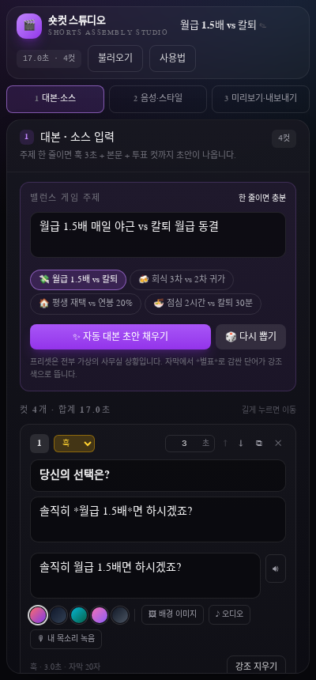
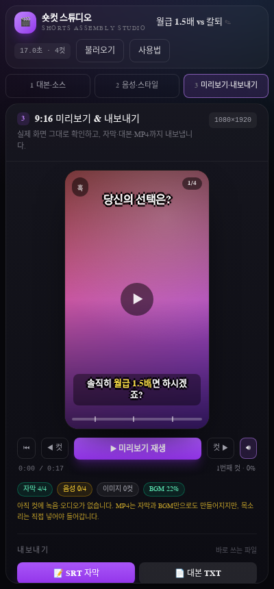
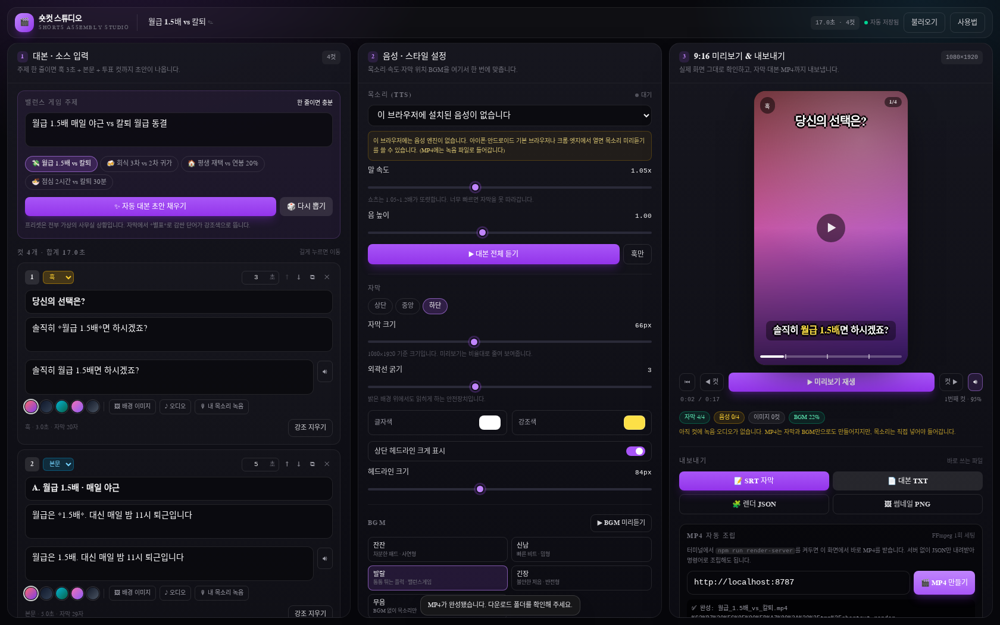
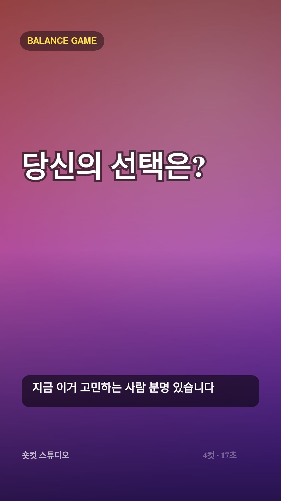

# 🎬 숏컷 스튜디오 (ShortCut Studio)

**3초 훅 대본부터 자막·BGM·MP4까지, 쇼츠 한 편을 한 화면에서 조립하는 9:16 세로 영상 스튜디오.**

주제 한 줄만 넣으면 훅 → A/B 본문 → 투표 컷까지 대본 초안이 나오고, 오른쪽 미리보기에서 실제 재생되는 화면을 보며
컷·자막·목소리·BGM을 맞춘 뒤, **SRT 자막 / 대본 TXT / 렌더 JSON / 썸네일 PNG / MP4**로 바로 내보냅니다.


---

## 1. 무엇을 하는 앱인가

| 패널 | 하는 일 |
| --- | --- |
| **① 대본 · 소스 입력** | 밸런스 게임 주제 입력 → **자동 대본 초안**(훅 3초 + 본문 2컷 + 투표 1컷). 컷별 헤드라인·자막·나레이션·길이 편집, 배경 그라디언트 5종 또는 이미지 업로드, 🎙 마이크로 그 컷 나레이션 직접 녹음 |
| **② 음성 · 스타일 설정** | 브라우저 TTS 목소리 선택, 말 속도·음 높이, **대본 전체 듣기**, 자막 위치(상/중/하)·크기·외곽선·글자색·강조색, 헤드라인 크기, BGM 분위기 4종·볼륨, BGM 미리듣기 |
| **③ 9:16 미리보기 · 내보내기** | 컷이 실제로 넘어가며 자막이 뜨는 **플레이어**(재생/일시정지·컷 이동·진행 바 스크럽), SRT/TXT/JSON/썸네일 내보내기, **로컬 렌더 서버로 MP4 조립** |

- **자막 강조**: 자막에서 `*단어*`처럼 별표로 감싸면 그 단어만 강조색으로 뜹니다. 미리보기·SRT·MP4가 모두 같은 규칙을 씁니다.
- **자동 저장**: 작업 내용은 브라우저 `localStorage`에 자동 저장됩니다. 이미지·녹음이 커서 용량을 넘기면 텍스트만 저장하고 상태 표시줄에 알려 줍니다.
- **모바일 대응**: 좁은 화면에서는 ①→②→③ 탭으로 전환됩니다.

| 모바일 (대본) | 모바일 (미리보기) |
| --- | --- |
|  |  |

---

## 2. 빠른 시작

### 준비물

| 항목 | 이유 | 설치 |
| --- | --- | --- |
| **Node.js 18+** | 스튜디오 실행·빌드 | https://nodejs.org |
| **FFmpeg** | MP4 조립 (브라우저 미리보기만 볼 거라면 없어도 됨) | 맥 `brew install ffmpeg` · 윈도우 `winget install ffmpeg` |
| **한글 폰트** | 영상에 한글 자막을 굽기 위해 | 맥·윈도우 기본 폰트를 자동으로 찾습니다. 없으면 `--font`로 지정 |
| Python 3.9+ | 렌더 스크립트 실행 (표준 라이브러리만 사용, 추가 설치 없음) | 맥 기본 포함 · 윈도우 https://python.org |

### 실행

```bash
cd shorts-assembly-studio
npm install
npm run dev            # http://localhost:5173
```

### MP4 만들기 — 두 가지 방법

**A. 화면에서 원클릭** (권장)

```bash
npm run render-server   # 터미널 하나 더 띄워서 실행 (http://localhost:8787)
```

스튜디오 오른쪽 아래 **[🎬 MP4 만들기]** 를 누르면 렌더 서버가 영상을 조립해 브라우저로 바로 내려줍니다.
(첫 렌더 기준 4컷·17초 영상이 약 20초 걸립니다.)



**B. 명령어로**

```bash
# 스튜디오에서 [🧩 렌더 JSON]을 내려받은 뒤
python3 scripts/render_shorts.py my_shorts.json -o my_shorts.mp4
```

`examples/sample-project.json`으로 바로 테스트해 볼 수 있습니다.

```bash
python3 scripts/render_shorts.py examples/sample-project.json -o sample.mp4
# 또는
npm run render -- examples/sample-project.json -o sample.mp4
```

### 빌드

```bash
npm run build      # tsc --noEmit + vite build  → dist/
npm run preview    # 빌드 결과 미리보기
```

---

## 3. 렌더 스크립트 옵션

```bash
python3 scripts/render_shorts.py <프로젝트.json> [옵션]
```

| 옵션 | 기본값 | 설명 |
| --- | --- | --- |
| `-o, --output` | `<json이름>.mp4` | 출력 파일 경로 |
| `--ffmpeg` | PATH 자동 탐색 | FFmpeg 실행 파일 경로 (`FFMPEG` 환경변수도 인식) |
| `--font` | 자동 탐색 | 한글 폰트 파일 경로 (예: `/System/Library/Fonts/AppleSDGothicNeo.ttc`) |
| `--font-family` | 자동 감지 | ASS 자막에 쓸 폰트 패밀리 이름 (자동 감지가 틀릴 때) |
| `--voice` | `auto` | 녹음이 없는 컷의 음성 처리: `auto`(espeak-ng 있으면 합성) · `espeak` · `none` |
| `--fit-audio` | 꺼짐 | 녹음이 컷 길이보다 길면 컷 길이를 늘려 잘리지 않게 함 |
| `--no-bgm` | 꺼짐 | BGM 없이 렌더 |
| `--crf` | `20` | 화질 (낮을수록 고화질·대용량) |
| `--preset` | `medium` | x264 프리셋 (`veryfast`로 빠르게) |
| `--srt-only` | | 자막(SRT)만 뽑고 종료 |
| `--keep-temp` | | 중간 파일 보존 (문제 확인용) |

렌더가 끝나면 **MP4 옆에 같은 이름의 `.srt`** 도 함께 저장됩니다.

같은 프로젝트를 MP4로 조립한 결과 — 자막은 libass로, 배경은 코드로 만든 그라디언트입니다.



---

## 4. 렌더 파이프라인 (실제로 일어나는 일)

```
project.json
   │
   ├─(1) 컷마다 1080×1920 영상 조각
   │      · 배경 이미지: cover 크롭 + zoompan(켄번즈) — 컷마다 확대/축소 방향이 번갈아 바뀜
   │      · 이미지가 없으면 테마 그라디언트 PNG를 코드로 생성해 같은 방식으로 애니메이션
   ├─(2) 컷 조각 concat (무손실 복사)
   ├─(3) 오디오: 컷별 [녹음 파일 | espeak-ng TTS | 무음] → 이어붙임 → BGM과 amix
   │      · BGM은 파이썬이 WAV를 직접 합성 (저작권·라이선스 걱정 없음)
   └─(4) 최종: 상·하단 스크림 오버레이 + ASS 자막 합성(libass) + loudnorm → H.264/AAC MP4
```

- **자막**은 브라우저 미리보기와 같은 데이터로 `ASS`를 만들어 굽습니다(위치·크기·색·외곽선·강조 단어 포함).
- **화면 비율·길이**는 프로젝트의 컷 길이 합계 그대로입니다. (미리보기 시간 표시와 일치)
- **목소리**는 브라우저 TTS를 MP4로 직접 넘길 수 없습니다(브라우저 보안). 그래서 컷 카드에서 **🎙 녹음**하거나
  **♪ 오디오 파일**(mp3/wav/m4a/webm)을 넣으면 그 소리가 그대로 들어갑니다. 아무것도 없으면 자막·BGM만 있는 영상이 나옵니다.

---

## 5. 프로젝트 JSON 구조

`[🧩 렌더 JSON]`이 내보내는 형식이며, `scripts/render_shorts.py`가 그대로 읽습니다.
(스튜디오가 `localStorage`에 저장하는 형식도 인식합니다.)

```jsonc
{
  "version": 1,
  "project": { "title": "월급 1.5배 vs 칼퇴" },
  "canvas": { "width": 1080, "height": 1920, "fps": 30 },
  "style": {
    "subtitle": { "position": "bottom", "sizePx": 66, "color": "#ffffff", "highlight": "#fde047", "outline": 3 },
    "headline": { "enabled": true, "sizePx": 84 },
    "voice": { "name": "브라우저 음성", "lang": "ko-KR", "rate": 1.05, "pitch": 1 },
    "bgm": { "mood": "playful", "volume": 0.22 }
  },
  "cuts": [
    {
      "id": "cut-1",
      "role": "hook",                    // hook | body | cta
      "headline": "월급 1.5배 vs 칼퇴",
      "subtitle": "이거 하나로 *회사생활* 갈립니다",
      "narration": "이거 하나로 회사생활 갈립니다.",
      "duration": 3,
      "theme": "sunset",                 // sunset | night | mint | candy | mono
      "image": null,                     // { "name": "...", "dataUrl": "data:image/png;base64,..." }
      "audio": null                      // { "name": "...", "dataUrl": "data:audio/webm;base64,..." }
    }
  ]
}
```

---

## 6. 자주 막히는 곳

| 증상 | 원인 / 해결 |
| --- | --- |
| `FFmpeg를 찾지 못했습니다` | `brew install ffmpeg` / `winget install ffmpeg` 후 터미널 재실행, 또는 `--ffmpeg /경로/ffmpeg` |
| 자막이 네모(□)로 나옴 | 한글 폰트를 못 찾은 경우. `--font`로 폰트 파일 지정 (예: 맥 `AppleSDGothicNeo.ttc`, 윈도우 `malgun.ttf`) |
| `MP4 만들기`가 연결 실패 | `npm run render-server`가 켜져 있는지, 주소(`http://localhost:8787`)가 맞는지 확인 |
| 목소리가 안 들어감 | 브라우저 TTS는 MP4에 들어가지 않습니다. 🎙 녹음 또는 ♪ 오디오 파일을 넣거나 `espeak-ng` 설치 후 `--voice espeak` |
| 목소리 미리듣기가 안 됨 | 브라우저에 음성 엔진이 없는 경우(특히 일부 리눅스·헤드리스). 크롬/엣지/사파리나 휴대폰 브라우저에서 열기 |
| 녹음이 안 됨 | 마이크 권한 필요. `localhost` 또는 HTTPS에서만 동작합니다 |
| 녹음이 컷보다 길어 잘림 | 컷 길이를 늘리거나 `--fit-audio` 사용 |
| PNG/JPG를 넣었는데 세로로 잘림 | 9:16에 맞춰 가운데 크롭됩니다(정상). 인물이 잘리면 미리 세로 이미지를 준비 |

---

## 7. 폴더 구조

```
shorts-assembly-studio/
├─ src/
│  ├─ App.tsx                  # 3패널 레이아웃 + 모바일 탭
│  ├─ components/
│  │  ├─ ScriptPanel.tsx       # ① 대본·소스
│  │  ├─ CutCard.tsx           # 컷 편집 카드 (이미지·녹음 포함)
│  │  ├─ StylePanel.tsx        # ② 음성·자막·BGM
│  │  ├─ PreviewPanel.tsx      # ③ 미리보기·내보내기
│  │  ├─ ShortsPlayer.tsx      # 9:16 재생 엔진
│  │  ├─ Header.tsx / GuideModal.tsx / ui.tsx
│  ├─ hooks/useStudio.ts       # 상태·자동 저장
│  └─ lib/                     # presets(대본 템플릿) · srt · tts · bgm(WebAudio) · media(내보내기) · recorder
├─ scripts/render_shorts.py    # FFmpeg 조립 스크립트 (표준 라이브러리만)
├─ server/render-server.mjs    # 로컬 렌더 서버 (의존성 없음, Node 18+)
├─ examples/sample-project.json
└─ docs/screenshots/
```

---

## 8. 소재와 권리에 대해

- 대본 프리셋 4종은 **전부 가상의 사무실 상황**입니다. 실존 인물·회사·실제 사건과 무관하며, 광고에 써도 문제가 없는 일반적인 직장 밸런스 게임 소재로만 구성했습니다.
- 자막 예시에 이름이 필요한 경우에도 실명 대신 `김 대리` 같은 가상의 호칭을 씁니다.
- **BGM은 앱이 직접 합성**합니다(브라우저 WebAudio / 파이썬 WAV 생성). 음원 라이선스 비용이나 저작권 표시 의무가 없습니다.
- 업로드한 이미지·녹음은 브라우저 안에서만 쓰이고, 렌더 서버는 로컬(`localhost`)에서만 동작합니다. 외부로 전송하지 않습니다.

## 9. GitHub에 올리기

빈 저장소를 하나 만든 뒤 아래 세 줄이면 됩니다. (`main` 브랜치로 커밋해 두었습니다.)

```bash
git remote add origin https://github.com/<내-아이디>/shorts-assembly-studio.git
git branch -M main
git push -u origin main
```

## 10. 참고

- 영상 규격: **1080×1920 · 30fps · H.264(High) · AAC 192kbps · faststart** — 인스타 릴스·유튜브 쇼츠·틱톡 공통 규격
- 컷 전환은 하드컷입니다. 미리보기의 자막 등장 애니메이션은 MP4에서 페이드(0.12초)로 들어갑니다.
