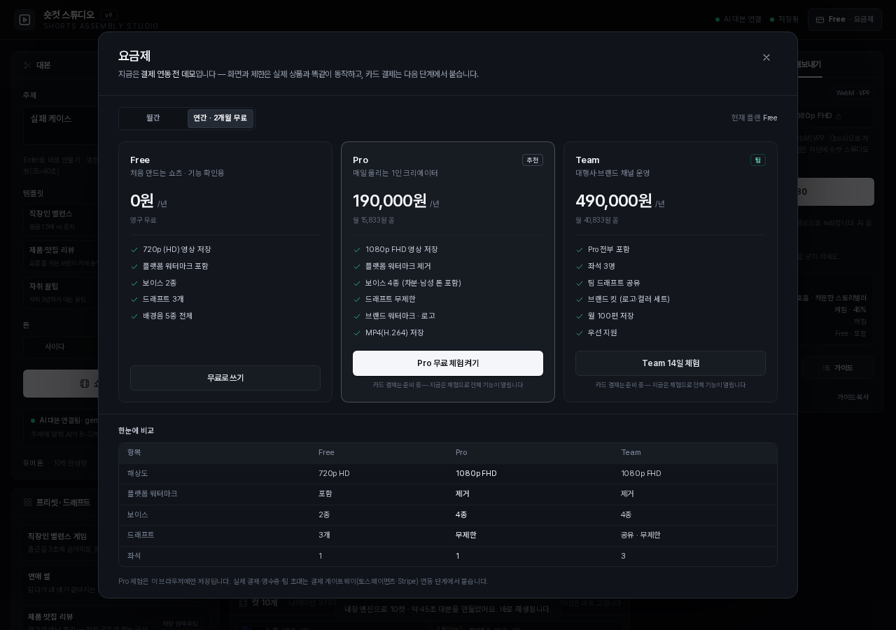
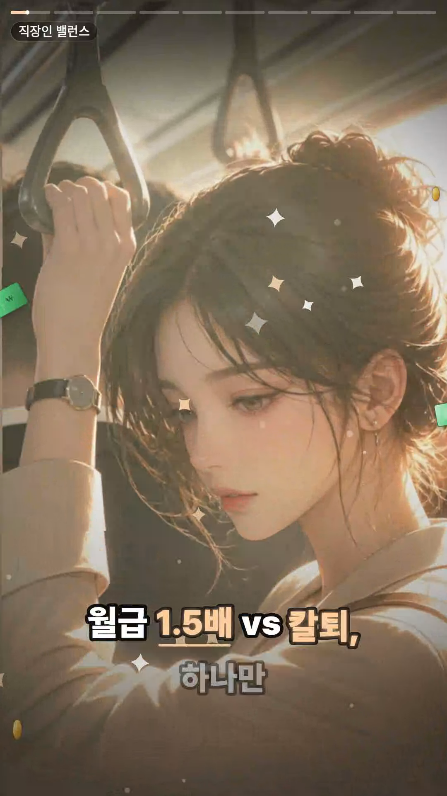

# 숏컷 스튜디오 (ShortCut Studio) v9

**주제 한 줄만 넣으면, 35~60초짜리 완성형 10컷 쇼츠 대본과 웹툰 일러스트 영상이 나옵니다.**
이제 **대본이 진짜 쇼츠처럼 길고**, **나레이션이 문장 단위로 이어서 읽습니다.**

빈약한 6컷 18초가 아니라 **8~12컷(기본 10컷) 35~60초 완성형 대본** — 후킹 → 문제 제기 → 근거·전개 →
반전·핵심 인사이트 → CTA. 컷마다 화면 자막과 **읽는 문장(나레이션)** 이 따로 있고, 이웃한 2~4컷의 문장은
**한 호흡(블록)으로 이어 읽힙니다.** 그래서 "안녕하세요, 오늘은…" 같은 AI 티 나는 끊김이 아니라
사람이 말하듯 이어지는 낭독이 됩니다. 목소리가 마음에 안 들면 **컷마다 직접 녹음하거나 성우 파일을 올려**
그 길이에 맞춰 컷을 다시 맞출 수 있습니다.
그림은 31장 일러스트가 컷마다 새로 배정돼 2.5D로 숨 쉬고(얼굴 고정, 머리카락·옷자락·배경이 미세하게 흔들림),
자막·배너·워터마크·음성·배경음(덕킹)까지 **한 파일(720p/1080p MP4·WebM)** 로 구워집니다.
Free / Pro / Team 요금제 구조와 게이팅도 실제로 붙어 있습니다(결제만 다음 단계).

> v9 = "직접 써 보고 돈을 낼 수 있는가"로 올린 판. 대본이 짧으면 아무리 그림이 좋아도 쇼츠가 아니고,
> 목소리가 로봇 같으면 아무도 자기 채널에 올리지 않습니다.


---

## 1. 이번 개편(v9) — 대본 밀도 · 이어 읽는 나레이션 · 내 목소리

> 직접 써 본 피드백: **"영상 계속 바뀌는 거 맞지? 근데 대본이 너무 쓸 수 있는 내용이 적다."**
> **"나레이션이 너무 AI 티가 나고, 너무 뚝뚝 끊겨."** **"AI로 만든 티가 많이 안 나야 돼."**

| v8 | 지금 (v9) |
| --- | --- |
| 6컷 · 약 18초 · 컷마다 자막 한 줄(그 자막을 그대로 읽음) | **8~12컷(기본 10컷) · 35~60초 완성형 대본.** 컷마다 `subtitle`(화면 자막 10~26자)과 `voice`(읽는 문장 25~60자)를 따로 씁니다. 구조는 후킹 → 문제 → 근거 → 반전 → CTA |
| 내장 대본이 4줄짜리 팁 나열 · 같은 문장 반복 | **완성형 대본 12편**(직장인 밸런스·자취·연애·리뷰·이슈·IT 각 2편, 40~55초) + 임의 주제용 **10컷 구조**(후킹→문제→근거 8→CTA)에 주제를 얹어 조립. 상투어 금지·구체 숫자 규칙 |
| 자막 하나(2~3초)마다 TTS 요청 → 문장이 뚝뚝 끊김 | **호흡 블록** — 이웃한 2~4컷의 나레이션을 최대 140자로 이어 붙여 **한 번에 요청·재생**. 10컷이면 요청 3~4회. 문장이 컷 경계를 넘어 이어지고, 억양이 살아 있음 |
| 브라우저 음성 폴백: 컷마다 `cancel()` 후 짧은 문장 하나 | **발화 큐** — 블록을 차례로 큐에 넣고 중간에 취소하지 않음. 말이 끊기지 않고, 컷은 저절로 넘어감 |
| 보이스 프리셋 4종(배속·필터만) | **화자 스타일 4종**(차분한 스토리텔러 · 뉴스 앵커 · 친근한 유튜버 · 드라마 예고) + **속도·톤·호흡·볼륨** 슬라이더. 목소리에 70Hz 하이패스 · 2.6kHz 존재감 · 중저역 온기 · 0.55초 방 울림을 더해 건조함·로봇티를 줄임 |
| 음성은 서버 음성 한 가지 | **음성 엔진 어댑터** — `provider=auto`로 `OPENAI_API_KEY`가 있으면 OpenAI TTS(말투 지시 포함), `ELEVENLABS_API_KEY`+`VOICE_ID`가 있으면 ElevenLabs, 없으면 키 없이 무료 Google 음성. 앱은 어떤 엔진으로 읽었는지 표시 |
| — | **내 목소리** — 컷마다 마이크 녹음(MediaRecorder) 또는 성우·클로바더빙 MP3/WAV 업로드 → 붙인 길이에 컷 길이가 자동으로 맞춰지고 미리보기·영상 저장에 그대로 들어감(IndexedDB 보관) |
| 컷 길이를 손으로 맞춤 | **음성에 컷 자동 맞춤** — 실제 음성 길이를 컷 글자 수 비율로 나눠 컷 길이를 다시 계산(0.1초 단위). 말이 잘리거나 화면이 멈춰 보이지 않음 |
| — | **타임라인** — 컷 길이에 비례한 클립 바, 재생 헤드, 호흡 블록 경계를 스테이지 아래에. 실제 편집기처럼 "지금 어디를 읽는지"가 보입니다 |
| 컷 전환마다 화이트 플래시·스트릭·글리치, 컷 번호 배지 | **덜어내기** — 플래시·스트릭은 훅/충격 컷에만, 자막 슬램·지터 축소, 컷 번호 배지 제거. 모서리·슬라이더도 더 각지고 조용하게 |

구현 요점

- `src/lib/scriptPacks.ts` — 12편의 완성형 대본(컷마다 자막·나레이션·장소). `localEngine.ts`는 매칭되는 팩을 그대로 쓰고, 없으면 카테고리 구조에 주제를 채웁니다.
- `src/lib/audio/narration.ts` — 호흡 블록 만들기(`buildNarrationBlocks`), 문장 잇기(`joinForBreath`), 길이 배분(`fitCutDurations`), 화자 스타일 프리셋.
- `src/lib/audio/takes.ts` — 마이크 녹음·오디오 디코드·IndexedDB 보관.
- `src/lib/audio/speechQueue.ts` — 브라우저 음성 발화 큐(중간 취소 없음).
- `api/generate.ts` — 프롬프트 전면 개편: 8~12컷, 후킹→전개→반전→CTA, `voice` 규칙(이웃 컷과 호흡 잇기), 금지 상투어 목록, duration 2.5~7초·합 35~60초, visual 규칙.

## 2. v8에서 바꾼 것 — AI 음성 · 프로 디자인 · 요금제

| v7 | 지금 (v8) |
| --- | --- |
| 음성은 브라우저 음성 읽기(미리듣기 전용, 영상에는 안 들어감) | **실제 한국어 AI 음성**을 컷마다 생성(`/api/tts`, Google Translate TTS·키 불필요)해 AudioBuffer로 풀고, **배경음과 한 그래프에서 섞어 영상 오디오 트랙으로 녹음**. 음성이 나오는 구간에는 배경음이 자동으로 낮아지는 **덕킹** |
| 보이스 설정 없음 | **보이스 프리셋 4종** — 또렷한 기본 · 빠른 숏폼 · 차분한 나레이션 · 낮은 남성 톤(배속·피치·저역 보강으로 갈라 만듦) + 속도·음성 볼륨 슬라이더, 컷별·전체 미리듣기 |
| 보라·분홍 그라데이션, 이모지 범벅, 박스형 대시보드 | **프로 다크 스튜디오** — #0B0D11/#13161D 중성 차콜, 1px 보더, 흰색 단색 기본 액션, 라인 SVG 아이콘(외부 패키지 0), Pretendard. 화면 이모지 0개 |
| 2단 세로 배치 | **데스크톱 3열**(대본·프리셋 / 9:16 스테이지·컷스트립 / 인스펙터 3탭), **모바일 탭 워크스페이스**(대본·스테이지·설정) |
| 요금제 없음 | **Free / Pro 월 19,000원 / Team 월 49,000원** — 월·연간 토글, 기능 비교표, **Pro 무료 체험(결제 연동 전 데모)**. Free는 720p·플랫폼 워터마크·보이스 2종·드래프트 3개, Pro는 1080p FHD·워터마크 제거·보이스 4종·드래프트 무제한 |
| WebM 고정 | 브라우저가 **H.264 MP4**를 지원하면 MP4 우선, 아니면 **WebM(VP9·Opus)** — 형식 배지로 명시 |
| 720×1280 고정 | **720p HD / 1080p FHD** 선택(1080p는 Pro) |

## 3. v7에서 바꾼 것 — 상용화

| v6 | v7 |
| --- | --- |
| 영상에 소리가 없음(합성 비트 한 종류) | **배경음 4무드**(트렌디 비트·로맨스·긴장·코믹)를 브라우저에서 합성. 볼륨·음소거·컷 전환 효과음까지 조절하고 **MediaStream으로 영상 파일에 실제 오디오 트랙(Opus)으로 녹음** |
| 일러스트 31장만 사용 | **컷마다 내 사진·캡처 업로드**(9:16으로 자동 크롭·축소) + **채널 핸들 `@`·로고 워터마크**를 캔버스에 구움 |
| 자막은 한 가지 스타일 | **자막 테마 4종**(임팩트·말풍선·네온·미니멀) × 위치 3 × 크기 3 |
| 컷 길이 고정(2.8~3.0초) | **컷 길이 0.8~12초 슬라이더** — 6컷 60초 정보형까지. 컷 순서 변경 유지 |
| 안전 영역 확인 불가 | **틱톡·릴스·쇼츠 UI 세이프존 오버레이**(미리보기 전용, 영상에는 안 들어감) |
| 프로젝트 하나만 자동 저장 | **이름 붙인 드래프트 저장·불러오기·삭제** + **원클릭 상용 템플릿 4종**(직장인 밸런스 게임·연애 썰·제품/맛집 리뷰·60초 이슈 요약) |
| 녹화 진행률만 표시 | **단계별 진행 표시**(준비→녹화→마무리), 남은 시간, **취소 버튼** |
| 콘텐츠 템플릿 4종 | **6종**(직장인 밸런스·연애 썰·제품/맛집 리뷰·60초 이슈 요약·자취 꿀팁·IT 트렌드) + 템플릿을 고르면 배경음도 자동 매칭 |
| 오류 시 화면이 죽으면 끝 | **에러 바운더리**(대본은 자동 저장, 새로고침으로 복구), AI 429·실패 시 내장 엔진 폴백 안내, 저장 공간 부족 안내 |

## 4. v6에서 바꾼 것

> 사용자 피드백: **"1 좋은데 지금 멈춰있는 사진이잖아 움직이게 못할까 영상처럼?"**
> v5는 일러스트 퀄리티는 올라갔지만, 한 장이 천천히 확대될 뿐이라 "사진"으로 보였습니다.

| v5 | 지금 (v6) |
| --- | --- |
| 일러스트 한 장을 통째로 켄 번즈 확대 (정지 사진 느낌) | **2.5D 워프** — 그림을 14×3 격자로 나눠 미세하게 어긋나게 그림. 얼굴은 그대로, 머리카락·옷자락·배경이 계속 흔들림 |
| 카메라가 컷마다 완만하게 한 번 | **비트 펀치** — 컷 안에서 자막 박자(16%·48%·80%)에 맞춰 2~3번 더 밀었다 놓음, 휩 팬·더치 앵글 추가 |
| 컷 전환은 화이트 플래시뿐 | **플래시 + 스피드 스트릭 + 줌 스미어 + 글리치 슬라이스** 로 휙 넘어감 |
| 자막은 HTML 오버레이(CSS 애니메이션) | **자막·배너·게이지를 캔버스에 구움** → 미리보기와 저장 영상이 100% 동일, 단어별 카라오케 + 키워드 발광·밑줄 |
| 미리보기 30fps, 배경 블러 때문에 실제로는 더 느림 | **60fps 지향** — backdrop-filter 제거, 기기 성능에 맞춰 미리보기 해상도 자동 조절 |
| 모션 세기 조절 없음 | **모션 강도 3단계(차분·생생·폭발)** — 미리보기에서 바로 바꾸고 저장 영상에도 같은 값 적용 |

### v5에서 이미 바꿔 둔 것

| 이전 (v4) | v5 |
| --- | --- |
| Canvas 도형으로 그린 막대·원형 캐릭터 — 사용자 평가: "PPT로 만든 일러스트" | **웹툰·로판 일러스트 31장**을 메인 비주얼로. 궁정 드레스·오피스 로맨스·비 오는 밤·카페 설렘·충격 클로즈업까지 실제 그림 |
| 컷마다 그림이 달라도 결국 같은 도형 캐릭터 | **컷마다 다른 일러스트**가 배정되고, 같은 영상에서 그림이 겹치지 않음 |
| 캔버스 도형 위에 이펙트만 얹음 | 일러스트 위에 **켄 번즈 카메라·색 보정·빛 번짐·파티클·전환 플래시·단어별 자막**을 합성 |
| 어두운 보라 UI, 각진 패널 | **크리에이터 스튜디오 감성** — Pretendard 자체 호스팅, 필름 그레인, 아트 썸네일 카드 |
| 주제와 그림의 결이 어긋남 | 주제가 '로판/계약 결혼'이면 **궁정 그림으로 고정**, '월급/칼퇴'면 **오피스 그림으로 고정** |

## 5. 요금제 (`src/lib/plan.ts`)

| | Free | Pro · 월 19,000원 | Team · 월 49,000원 |
| --- | --- | --- | --- |
| 영상 해상도 | 720p HD | **1080p FHD** | 1080p FHD |
| 플랫폼 워터마크 | 포함 | **제거** | 제거 |
| 보이스 | 2종 | **4종** | 4종 |
| 드래프트 | 3개 | 무제한(24) | 공유·무제한 |
| 좌석 | 1 | 1 | 3 |

- 헤더의 플랜 배지 → **요금제 모달**. 월간/연간(2개월 무료: 190,000원·490,000원) 토글, 플랜별 기능 비교표.
- 결제 게이트웨이는 아직 붙이지 않았습니다. 대신 **"Pro 무료 체험 켜기"**가 실제 제한을 풉니다 —
  1080p 선택, 플랫폼 워터마크 제거, 보이스 4종, 드래프트 한도가 즉시 바뀌고 `localStorage`에 남습니다.
  (토스페이먼츠·Stripe 연동 시 이 상태를 구독 상태로 바꾸면 그대로 상품이 됩니다.)

## 6. 1분 사용법

0. **원클릭 상용 템플릿**을 눌러도 됩니다 — 대본·길이·자막·배경음이 끝난 상태로 바로 재생됩니다.
1. **주제**를 한 줄 적습니다. 예: `월급 1.5배 vs 칼퇴`, `계약 결혼 1년 후, 남편이 기억을 잃었다`
2. **템플릿**(직장인 밸런스 · 자취 꿀팁 · 연애 썰 · IT 트렌드)과 **톤**(사이다 · 공감 · 유머)을 고릅니다.
3. **쇼츠 대본 만들기** — 8~12컷(기본 10컷) 완성형 대본과 함께 컷마다 일러스트가 배정되고 바로 재생됩니다.
4. 흐름이 마음에 안 들면 왼쪽 컷 카드에서 **자막**과 **나레이션 문장**을 따로 고칩니다(나레이션을 비우면 자막을 읽습니다).
5. 오른쪽 **오디오 · TTS** 탭에서 **화자 스타일**(스토리텔러·앵커·유튜버·드라마)과 속도·톤·호흡을 정하고 **전체 듣기**로 확인합니다(호흡 단위 상태).
   목소리를 직접 넣고 싶으면 **내 녹음 · 파일**로 바꿔 컷마다 녹음하거나 MP3/WAV를 올립니다.
6. **자막 · 브랜드** 탭에서 자막 테마·위치·크기, 채널 핸들·로고를 정합니다.
7. **내보내기** 탭에서 해상도(720p/1080p)를 고르고 **영상 저장** — 나레이션·배경음·자막·워터마크가 한 파일에 구워집니다(진행률·취소 지원).
8. 대본이 필요하면 **대본 복사 / 자막 .srt / 컷별 가이드**로 꺼냅니다. 마음에 드는 상태는 **드래프트로 저장**해 두세요.

- 자막에서 `*단어*`처럼 별표로 감싸면 그 단어만 강조색으로 뜨고, 음성에서는 별표를 빼고 읽습니다.
- 만들 때마다 새 시드가 생겨 **같은 주제라도 컷 구성·카메라·색·이펙트가 달라집니다.**

| 모바일 (390px) | AI 대본 모드 |
| --- | --- |
|  |  |

**한 영상의 10컷 — 컷마다 다른 일러스트와 카메라**


**요금제** — Free / Pro / Team, 월·연간 토글과 기능 비교



**저장된 영상의 실제 프레임** (일러스트 + HUD + 자막 + 플랫폼 표식까지 그대로 구워집니다)


**Pro 1080p로 저장한 프레임** (플랫폼 표식 없음)



## 7. 일러스트 라이브러리 (`public/webtoon/`)

9:16(720×1280 WebP, 총 3.6MB) 일러스트 31장을 장르별로 나눠 두었습니다.
원본 941×1672 PNG와 생성 프롬프트는 `docs/art-catalog.md`, 원본은 `downloads/shortcut-studio-webtoon-masters/`에 있습니다.

| 장르 | 장수 | 예 |
| --- | --- | --- |
| 로맨스 판타지 | 6 | 은빛 드레스의 무도회 · 손을 내미는 공작 · 달빛 정원의 산책 · 황궁의 대연회장 · 황실 근위대장 · 눈 내리는 궁정 |
| 오피스 | 7 | 야근 중인 사무실 · 회의실의 충격 · 커피 한 잔의 여유 · 엘리베이터의 정장남 · 옥상에서의 노을 · 상사와의 대치 · 만원 지하철 |
| 비·감정 | 4 | 비 오는 밤 우산 아래 · 혼자 남은 비 오는 거리 · 빗물에 비친 얼굴 · 눈물 한 방울 |
| 카페 로맨스 | 3 | 창가 자리의 미소 · 마주 앉은 두 사람 · 라테 두 잔 |
| 코믹·사이다 | 4 | 한숨 나오는 순간 · 믿기지 않는 순간 · 해냈다, 사이다 · 월급이 쏟아진다 |
| 네온·IT | 4 | 출시 성공 · 네온 골목 · AI 작업실 · 도시의 밤 |
| 자취·일상 | 3 | 불 끄기 전 자취방 · 아침의 주방 · 벚꽃 산책 |

### 어떻게 컷에 배정되나 (`src/lib/motion/art.ts`)

- 각 일러스트에 한국어 **태그**(`궁정`, `야근`, `소개팅`, `지하철` …), 표정, 구도(close/medium/wide/two-shot), 초점 좌표, 강조색, 어울리는 공기(비·꽃잎·보케)를 붙였습니다.
- 대본의 `visual.scene`·소품·표정·자막을 읽어 태그 점수를 매기고, **템플릿·톤 적합도**, 컷 역할(훅/본문/CTA), 두 사람 구도까지 더해 고릅니다.
- 주제가 장르를 확실히 말하면(`로판·공작·계약 결혼` → 궁정, `월급·칼퇴·야근` → 오피스) 그 장르 안에서만 고릅니다. 장르 그림이 5장 이상일 때만 고정합니다.
- **같은 영상에서 이미 쓴 그림은 제외**하고, 앞 컷과 같은 장르·구도는 감점해 6컷이 겹치지 않습니다.
- 시드가 바뀌면 점수가 비슷한 후보 중 다른 그림이 뽑혀, 같은 주제를 다시 만들어도 새 영상이 됩니다.

## 8. 모션 엔진 (`src/lib/motion/`)

- **살아 있는 그림(live.ts)**: 일러스트를 14×3 격자로 나눠 그립니다. 초점(얼굴)에서 멀수록 크게 흔들리는
  변위장(사인파 2중 + 가우시안)을 적용하고, 인물은 카메라 이동의 반대로 조금 늦게 따라오게 해 **깊이(2.5D)** 를 만듭니다.
  격자 이음매는 30px 겹쳐 그려 보이지 않습니다.
- **카메라 10종**: push(줌인) · pull(줌아웃) · punch(펀치인) · whip(휩 팬) · drift(패닝) · tilt · shake · handheld · orbit · slide.
  컷 안에서 자막 박자에 맞춰 `beatPulse`가 2~3번 더 밀어 주고, 진입 순간에는 오버슈트(`entryKick`)가 붙습니다.
  일러스트의 초점(얼굴)을 중심으로 확대하되 화면 밖으로 밀리지 않게 이동 범위를 계산해, 확대·회전에도 그림 가장자리가 드러나지 않습니다.
- **화면 마감**: 컷마다 다른 색 보정 · 얼굴 쪽 빛 번짐 · 흐르는 빛 번짐(light leak) · 위에서 내려오는 빛줄기 ·
  비네트 · 필름 그레인 · 컷 진입 화이트 플래시 + 스피드 스트릭 + 줌 스미어 + 글리치 슬라이스.
- **공기와 효과**: 비 · 눈 · 꽃잎 · 보케 · 먼지 · 반짝임 · 지폐/동전 · 하트 · 색종이 · 집중선 · 유리 파편 · 김 · 땀 · 번개 · 광선.
  효과는 그 컷의 자막에서만 뽑고 영상 전체에서 몇 번으로 제한해, 모든 컷에 같은 효과가 깔리지 않습니다.
- **자막**: 컷 길이에 맞춰 단어가 차례로 박히는 카라오케. `*강조*` 단어는 강조색 + 발광 + 밑줄이 그어지고
  박힌 뒤 한 번 더 맥동합니다. CTA의 짧은 문장은 **말풍선**에 담깁니다. 문장부호가 다음 줄로 떨어지지 않게 단어에 붙여 렌더합니다.
- **HUD**: 상단 후킹 배너(맥동 + 지나가는 빛), 6칸 진행 게이지(머리에 빛), 컷 번호까지 캔버스에 굽습니다.
- 플레이어(`ShortsPlayer.tsx`)와 녹화(`record.ts`)가 **같은 `renderFrame()`·같은 옵션**을 쓰므로 미리보기와 저장 영상이 100% 같습니다.
- 미리보기는 매 프레임 그리고 UI 숫자만 8fps로 갱신하며, 프레임이 무거우면 캔버스 해상도를 스스로 낮춥니다(녹화는 항상 720×1280).
- 그림은 `artLoader.ts`가 미리 불러오고, 아직 안 온 컷은 대표색 그라데이션으로 먼저 채워 검은 화면이 보이지 않습니다. 영상 녹화 전에는 6장과 웹폰트를 모두 기다립니다.

## 9. 사운드 엔진 (`src/lib/audio/`)

### 9.1 나레이션 음성 (`api/tts.ts` · `narration.ts` · `tts.ts` · `mixer.ts` · `takes.ts`)

- **호흡 블록**: 컷의 `voice` 문장을 이웃 컷과 이어 붙여 최대 140자 블록을 만듭니다(`buildNarrationBlocks`).
  블록 하나가 한 번의 음성 요청이 되므로 10컷 대본이 3~4번의 긴 낭독으로 읽힙니다. 블록 안에서 컷이 바뀌어도
  목소리는 끊기지 않고, 컷 길이는 블록의 실제 음성 길이를 글자 수 비율로 나눠 다시 맞춥니다(`fitCutDurations`, 기본 켜짐).
- `GET /api/tts?text=…&voice=…&style=…&provider=auto` — 서버리스 함수가 음성을 만들어 돌려줍니다.
  - **OpenAI TTS** (`OPENAI_API_KEY`가 있으면): `gpt-4o-mini-tts`, 보이스 프리셋별 목소리, 화자 스타일에 맞는 `instructions`.
  - **ElevenLabs** (`ELEVENLABS_API_KEY` + `ELEVENLABS_VOICE_ID`): `eleven_multilingual_v2`.
  - **Google Translate TTS** (키 없이 무료, 기본): 170자 단위로 끊어 요청하고 이어 붙입니다.
  - 인스턴스 메모리에 최근 240건을 캐시(`Cache-Control: immutable`), 1분 60회 제한, 실패 시 `502`.
    앱은 그때 브라우저 음성으로 미리보기만 이어 갑니다(영상에는 안 들어감).
- **보이스 프리셋 4종**: 또렷한 기본 1.00× · 빠른 숏폼 1.10× · 차분한 나레이션 0.93×(저역통과 8.2kHz) ·
  낮은 남성 톤 0.86×(저역 +4.5dB·저역통과 6kHz). **화자 스타일**이 그 위에 속도·음높이·호흡·온기를 더합니다.
- **목소리 다듬기**(`mixer.ts`): 70Hz 하이패스로 웅웅거림 제거 → 2.6kHz 존재감 +1.2dB → 중저역 온기(스타일별 0~4dB)
  → 0.55초 지수 감쇠 방 울림 5.5% wet. 배속은 `playbackRate`, 톤은 `detune`(센트)로 걸고 실제 길이는 그 배율로 계산합니다.
- **덕킹**: 음성 구간 140ms 전부터 배경음 버스를 30%로 낮추고 끝나면 220ms에 걸쳐 되돌립니다.
  연속된 블록은 올렸다 내리지 않고 이어서 낮게 유지합니다(블록 사이에 배경음이 튀지 않음).
- **내 목소리**(`takes.ts`): 컷마다 `getUserMedia`+`MediaRecorder`로 녹음하거나 MP3/WAV/M4A를 올려 디코드하고
  그 길이에 맞춰 컷을 늘립니다. 미리보기·영상 저장이 같은 AudioBuffer를 쓰고, IndexedDB(`shortcut-studio/takes`)에
  조용히 보관해 새로고침해도 남습니다. 마이크 권한이 없으면 그 문장으로 안내합니다.

### 9.2 배경음 (`bgm.ts`)

- **무드 4종**을 코드 진행·드럼·베이스·아르페지오·패드·멜로디로 조합해 `buildScore()`가 초 단위 악보로 펼칩니다.
  같은 무드·같은 길이면 항상 같은 소리(미리보기와 녹화가 같은 악보를 씁니다).
- 오실레이터·노이즈 버퍼로 그 자리에서 합성하고, 컴프레서·짧은 딜레이로 다듬습니다. 음원 파일·외부 API 없음 → **저작권 걱정 없음**.
- 스케줄러는 90ms마다 0.6초 앞을 예약하고, 컷 시작 시각에는 밴드패스 스윕 **휙 넘어가는 효과음**을 넣습니다.
- 배경음 엔진은 소리를 직접 스피커로 보내지 않고 `AudioMixer`의 **배경음 버스**로만 보냅니다.
  미리보기는 그 버스를 스피커로, 영상 저장은 **MediaStreamDestination**으로 이어 `MediaRecorder`가 영상과 함께 기록합니다
  (녹화 중 소리가 밖으로 새지 않음). 오디오 장치가 없는 환경에서는 2.5초 안에 포기하고 무음 영상으로 정상 녹화합니다.
- 볼륨·음소거는 미리보기와 녹화에 동시에 적용되고, 음성 덕킹은 같은 버스에서 처리됩니다.

### 9.3 영상 형식 (`motion/record.ts`)

- 브라우저가 `video/mp4;codecs=avc1…,mp4a…`(H.264/AAC)를 지원하면 **MP4 우선**.
  codec 없이 `video/mp4`만 지원한다고 답하는 브라우저(VP9이 MP4에 들어가는 경우)는 편집 앱·플랫폼 업로드에서
  거절되므로 **WebM(VP9·Opus)으로 폴백**하고 배지에 형식을 명시합니다.
- 녹화 해상도는 720×1280(Free) / 1080×1920(Pro). 비트레이트도 해상도에 맞춰 올립니다.

## 10. 검증

```bash
npm run typecheck     # tsc (앱 + API)
npm run build         # tsc + vite build
npm run test:e2e      # Playwright E2E (정적·모바일·AI·키없음·음성어댑터 5가지 모드)
python3 scripts/verify.py offline   # 한 모드만 (컨테이너가 느릴 때)
```

E2E는 **279개 항목**(정적 184 · 모바일 8 · AI 69 · 키 없음 9 · 음성 어댑터 9)을 확인합니다.

- **대본 밀도**: 8~12컷 · 35~60초 · 컷마다 자막과 나레이션 문장이 따로 있고 평균 22자 이상 · 같은 문장 반복 없음 · 금지 상투어 없음 · 첫 컷 훅/마지막 컷 CTA.
- **나레이션**: 호흡 블록 수 < 컷 수, 첫 블록에 1·2번 컷 문장이 이어짐, TTS 요청 수 < 컷 수(요청당 평균 60자 이상),
  화자 스타일·보이스가 서버로 전달됨, 블록마다 음성이 믹서에 얹히고 덕킹 계수가 블록 수 이상,
  **영상 전체 길이가 음성 길이에 자동 맞춤**(±2.5초), 1080p 영상에 블록 음성이 들어가고 파형이 실제로 남음.
- **내 목소리**: WAV 업로드 → 컷에 붙고 컷 길이가 2.2~3.2초로 맞춰짐, 믹서로 미리듣기, 지우기, 마이크 권한 거부 안내, AI 음성 복귀.
- **음성 어댑터**: `provider=openai`로 OpenAI 음성, `provider=google` 폴백, 키 없는 엔진은 501, 앱이 엔진 이름을 표시.
- **디자인·편집기**: 3열 레이아웃·인스펙터 3탭·이모지 0개·그라데이션 없는 배경, 타임라인 클립·재생 헤드·호흡 경계.
- **영상 저장**: WebM/MP4 파일 생성, 720p/1080p, 오디오 트랙과 실제 파형, **저장 영상 프레임을 브라우저로 디코드해**
  첫 컷 일러스트가 구워졌는지(색 대조)·두 시점 프레임이 다른지(모션)·자막·배너·플랫폼 표식이 있는지(픽셀 비율).
- 그 밖에 v6~v8 검증(카메라 움직임·warp·결정적 렌더·모션 3단계·요금제 게이팅·드래프트·내 이미지·세이프존)을 그대로 유지합니다.

## 11. 파일 구조

```
api/
  generate.ts     AI 대본(Vercel Serverless, Gemini/OpenAI)
  tts.ts          나레이션 음성(OpenAI·ElevenLabs 어댑터 + Google 번역 TTS 폴백·분할·캐시)
src/lib/audio/
  narration.ts    호흡 블록·문장 잇기·컷 길이 자동 맞춤·화자 스타일 4종
  mixer.ts        배경음+나레이션 통합 믹서(버스·덕킹·목소리 후처리·MediaStream 출력)
  tts.ts          음성 프리셋 4종·엔진 상태·요청·디코드·캐시·브라우저 음성 폴백
  speechQueue.ts  브라우저 음성 발화 큐(블록을 이어 읽기)
  takes.ts        내 목소리 — 마이크 녹음·오디오 파일 디코드·IndexedDB 보관
  previewVoice.ts 한 컷/한 문장 미리듣기
  bgm.ts          배경음 4무드 합성·스케줄러
src/lib/
  scriptPacks.ts  완성형 대본 12편(컷마다 자막·나레이션·장소)
  customArt.ts    내 이미지 보관함(9:16 크롭·축소·localStorage)
  presets.ts      원클릭 상용 템플릿 4종
  projects.ts     이름 붙인 드래프트 저장·불러오기
  defaults.ts     사운드·자막·브랜드 기본값
src/components/
  Header.tsx          상단 바(플랜·상태·요금제)
  Inspector.tsx       오른쪽 인스펙터 3탭
  AudioPanel.tsx      배경음 · AI 나레이션 · 내 녹음/파일
  Timeline.tsx        컷 클립·재생 헤드·호흡 경계
  CaptionBrandPanel.tsx 자막 테마 · 브랜드 워터마크
  ExportPanel.tsx     해상도·형식·나레이션 포함 저장
  PricingDrawer.tsx   Free / Pro / Team 요금제
  ProjectPanel.tsx    프리셋·드래프트
  Icon.tsx            라인 SVG 아이콘(외부 패키지 없음)
  ErrorBoundary.tsx   화면 오류 시 복구
src/lib/motion/
  art.ts          일러스트 31장 메타데이터 + 컷 배정 로직(태그 점수·장르 고정)
  artLoader.ts    WebP 프리로드·캐시 (진행 알림)
  stage.ts        1080×1920 스테이지, 비트 펀치 카메라 10종, 모션 강도, 글로우 스프라이트
  live.ts         2.5D 워프(살아 있는 그림), 진입 버스트·글리치·빛 번짐
  scene.ts        대본 → 컷별 그림·카메라·이펙트·팔레트
  draw.ts         한 프레임 렌더(워프 일러스트 + 보정 + 파티클 + 전환 + 자막·HUD)
  effects.ts      파티클·빛·전환 효과
  captions.ts     자막·HUD 굽기
  record.ts       720×1280 WebM 녹화(배경음 오디오 트랙 포함, 진행률·취소)
public/webtoon/   생성한 일러스트 31장 (WebP)
docs/art-catalog.md  일러스트별 장면 이름과 생성 프롬프트
docs/screenshots/    실제 화면·컷·영상 프레임
```

---

그림은 모두 이 저장소를 위해 생성한 오리지널 일러스트이고, 런타임에는 이미지 API를 호출하지 않습니다.
